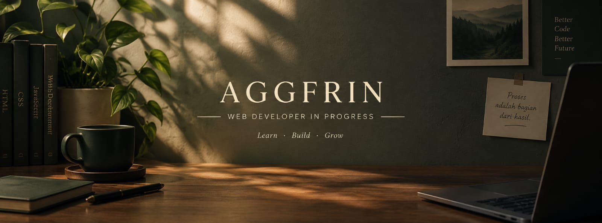

  

# 👋 Bismillah. Sholallahu ala Muhammad
Halo, saya Agung fajrin!

### 🌿 Web Developer in Progress

Selamat datang di profil GitHub saya!

Saya sedang belajar dan mengembangkan proyek website yang sederhana, elegan, yang insysaAllah bermanfaat. Saya percaya bahwa setiap proyek adalah kesempatan untuk belajar dan menjadi lebih baik.

---

## 🚀 Proyek Unggulan

### 🍽️ Maslahah Catering
Website layanan aqiqah dan catering dengan tampilan elegan dan informatif.

🔗 **Kunjungi Website:**  
https://maslahah-catering.pages.dev/

---

## 🛠️ Teknologi yang Saya Pelajari

  
  
  
  

---

## 🎯 Fokus Saya

- 🌐 Mengembangkan website yang responsif
- 🎨 Mempelajari desain web yang bersih dan elegan
- 💡 Membangun proyek nyata untuk terus berkembang

---

### ✨ Terus belajar, terus bertumbuh.

*Terima kasih sudah mengunjungi profil saya!*
---

## 📊 GitHub Overview

  
  

---

  <i>Learn · Build · Grow</i>

